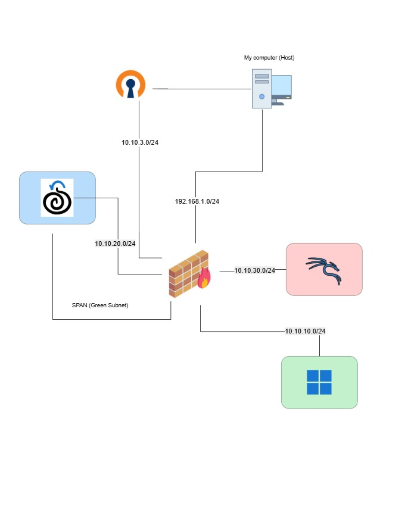
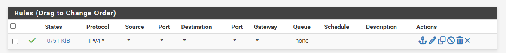
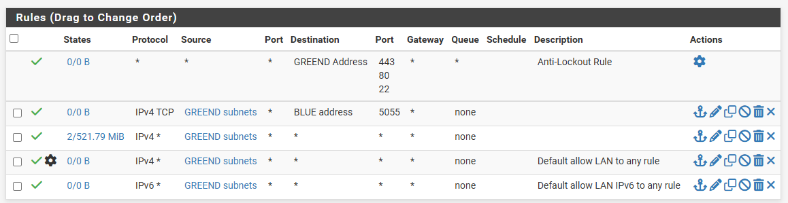
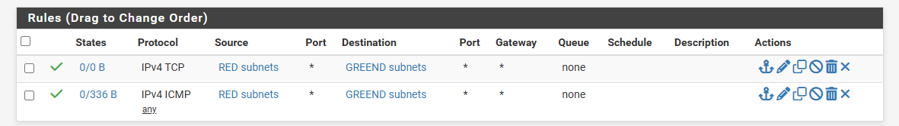
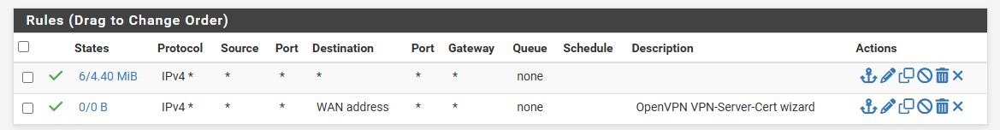
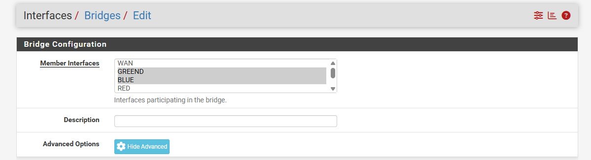
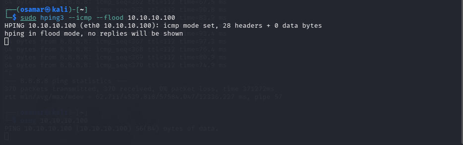
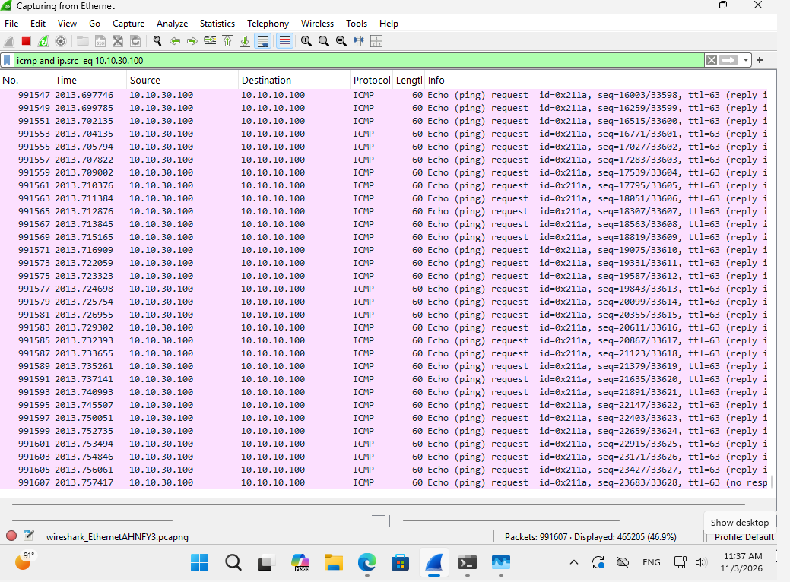
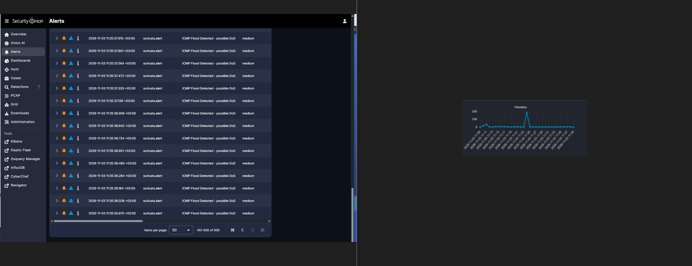
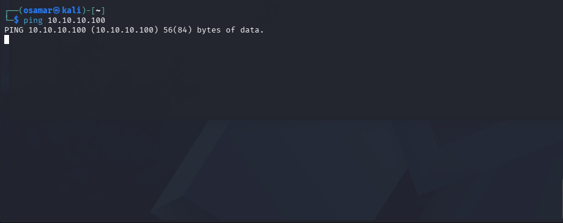

# Objective

A hands-on cybersecurity lab focused on simulating and investigating Denial-of-Service (DoS) and Distributed Denial-of-Service (DDoS) attack scenarios in a controlled environment.
The lab uses Windows 11, Kali Linux, pfSense, and Security Onion to simulate attack workflows involving ICMP, TCP/SYN, and HTTP traffic. Network activity is monitored and analyzed using tools such as Zeek and Wireshark, with Security Onion and Kibana used for security monitoring, log analysis, and visualization.

# 1. Prerequisites

## 1.1 Machines

- VirtualBox
- Kali Linux vm
- Windows vm
- pfSense
- Security onion

## 1.2 Tools

- hping3
- tmux
- Wireshark

# 2. Lab setup

## 2.1 Networking

### 2.1.1 Network toplogy

### 2.1.2 Subnets

| Name  | Machine     | IP           |
| ----- | ----------- | ------------ |
| Green | Wiondows 11 | 10.10.10.100 |
| Blue  | Value 5     | 10.10.20.100 |
| Red   | Value 2     | 10.10.30.100 |
| VPN   | Value 5     | 10.10.3.2    |

### 2.1.3 Ineterfaces

| Virtual Box | Pfsense |
| WAN | Bridged Adapter |
| em1 | intnet-Green|
| em2 |intnet-Blue |
| em3 | intnet-Red |
| em4 | Span |

### 2.1.4 Firewall Rules

### Blue

### Green

### Red

### WAN

### 2.1.5 SPAN Port configuration

### 2.2 Monitoring Stack

- Security Onion: monitoring/analysis platform
- Zeek: network telemetry
- Suricata: network IDS/alerts
- Wireshark: packet-level analysis
- Kibana: searching/visualization

# 3. Attack Scenarions

## 3.1 Dos ICMP Attack

### Attack Definition

ICMP is a layer 3 protocol used for diagnosing troubleshooting communication problems between network devices. In this attack, The attacker starts sending a huge volume of these packets to the point where the attacker can't keep up with them, which results in degraded connectivity to that host.

\_figure shows normal working of ICMP protocol\_

\_figure shows the ping flood attack. The Victim can't handle the excessive amount of requests resulting in network congestion, and degraded connectivity.

### Attack initation

_figure shows hping3 icmp flood command run against the victim ip address_

_figure shows the flood of icmp requests originating from the attacker ip `10.10.30.100` and received by the victim vm_

### Detection

for the IDS I used this rule for Suricata to raise an alert if the victim receives 50 packets per 5 seconds as a possiblity of a DOS/DDos attack happening: `alert icmp any any -> $HOME_NET any (msg:"ICMP Flood Detected - possible DoS"; itype:8; threshold:type threshold, track by_src, count 50, seconds 5; classtype:attempted-dos; priority:2; sid:1000001; rev:1;)`

_figure on security onion shows the spike of the amount of packets at the same time of the attack as well as the Suricata alert being fired_

### Attack Impact

_figure shows extremly slow ping responses around 1 ping reponse in 10 minutes which indicates the high bandwidth consumption _
